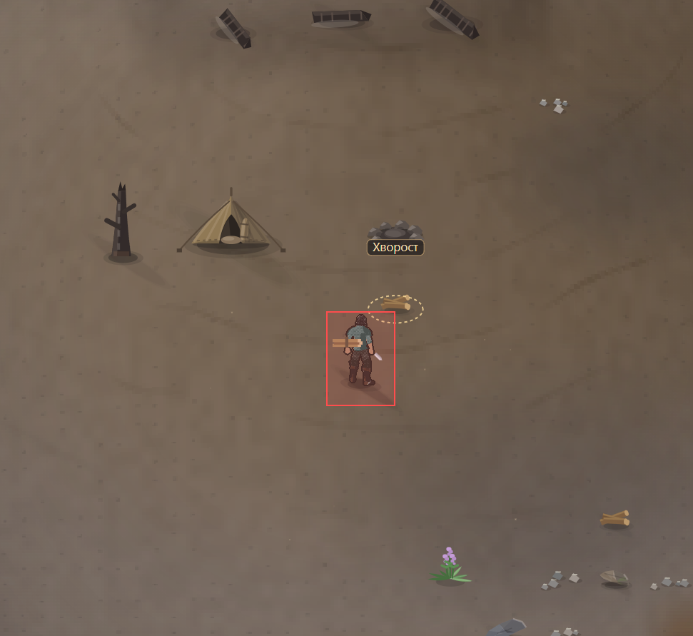

# Посмотри, предмет на спиной, а ещё глянь то как пиксели просвечиваются, следующим скрином покажу, вид спереди

**Актуальный статус · 2026-11-24, блок 70:** принято, исправлено в этом блоке.
1. *Порядок предмета и тела* больше не выводится из направления взгляда: запекка
   сравнивает глубину кисти с буфером глубины кадра и пишет на каждый кадр
   `META.occl[dir/pose][r|l][i]` — скрыта рука за корпусом или нет. Рантайм
   (`js/render/character.js`) рисует предмет ДО спрайта только у скрытой руки,
   поэтому спереди обе кисти открыты и клинок поверх ладони, а в профиль дальняя
   рука уходит за корпус. Проверка: `node tools/scene.js --dir left --tool
   axe_stone --hand right`, тест «which hand is behind the body…».
2. *Просвечивающие пиксели.* Причин было три, все закрыты: тело базовой модели
   вырезалось до одной головы (дыры в рукавах смотрели прямо в небо) — теперь оно
   подкладка, утянутая по нормали (`--shrink 0.97 --inset 0.02`); квантизация
   оставляла замкнутые пустоты на стыках — `closeHoles` зашивает пиксели,
   окружённые силуэтом; дизеринг пиксель-в-пиксель читался как «ткань
   полупрозрачная» — перешли на блок 2×2 (`photopix.js`, `DITHER_BLOCK`), а силуэт
   в обоих модулях теперь без единой дырки: `node tools/sprite-holes.js
   js/render/heroframes.js` → «замкнутых дыр в силуэте нет», то же для herosmooth.
3. *Волосы и лицо.* Причёска подгоняется по габариту головы и вырезает пряди
   перед лицом (`fitHairToHead` + `--hairwidth/--hairlift`), свет в запекке
   смотрит на персонажа, а не от него, а глаза и брови печатаются отдельным
   штампом по сетке спрайта (`stampFeatures`) — иначе меш глаз размером 0.03 ед.
   размывался в кожа́нный тон и лицо было пустым.
4. *Мокнет и снег.* Слой погоды лег на спрайт (`heroWeatherTint`,
   `source-atop` внутри силуэта): дождь и буря темнят и холодят, снег кладёт
   иней, под крышей и в ясную погоду слоя нет.

- **зона:** Пепелище у дома (`ashfall`)
- **область:** 40×42 px от (1064, 1233) — тайлы 33,38 … 34,39
- **время:** день 1, 18:15, spring
- **погода:** cloudy
- **зум:** 2.4
- **повторить:** `node tools/scene.js --zone ashfall --at 1084,1254 --day 1 --hour 18.25 --weather cloudy --wet 0 --zoom 2.4 --seed 1066618561`

- **Интерфейс:** {"mode":"desktop","panel":null,"objective":"Осмотреть обгоревшую печь","hands":{"left":{"id":"firewood","n":3},"right":{"id":"knife","n":1}},"dominant":"right","origin":"https://sbx-ruh6uq7uoogmfxy2.arena.site"}

<!-- 2026-11-24T19:38:27.138Z -->

<!-- receipt: 4eac03412a2bc27582886defa6ae9cc389d60a791f64ad67ce491d9eb951710e -->
